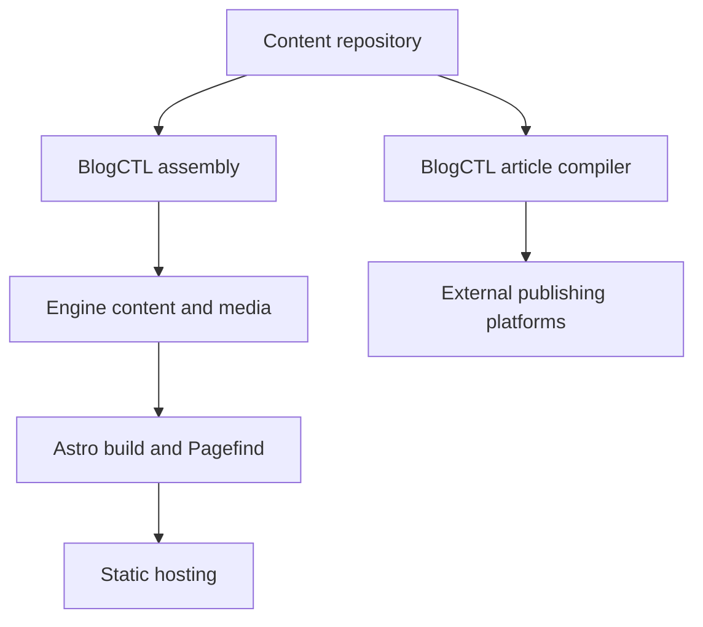

# How content becomes a website

Inkerio turns a separately versioned content repository into a bilingual static website. BlogCTL assembles the build inputs and also provides a separate route for publishing articles to external platforms.

## Data flow

The public [inkerio-content-template](https://github.com/ThinkerQAQ/inkerio-content-template) supplies sample content. For your own site, create a content repository from it. The engine repository retains its existing name, `ThinkerQAQ.github.io`.

## Ownership

| Part | Owns |
| --- | --- |
| Content repository | Markdown, translations, source media, workout records and optional content manifest |
| Engine `src/` and `astro.config.mjs` | Routes, layouts, metadata, SEO, RSS and collection schemas |
| `tools/blogctl/` | Assembly, article compilation, asset processing, publishing, indexing and browser Bridge |
| `scripts/` and `src/markdown/` | Diagram rendering and site build support |
| `.github/workflows/` | Build, release and deployment orchestration |
| `workers/` | Separately configured tracking, reports, reactions and optional AI retrieval |

Assembly replaces generated `src/content/` in the engine. When source media is present it replaces the corresponding engine media tree. The original content checkout is not modified. Edit and commit writing there; engine upgrades and repeated assemblies can then regenerate the website inputs.

The [tutorial](../tutorial/first-site.md) follows this separation using two local checkouts. Built output lives in `dist/`, including Pagefind indexes. Static hosts serve those files; they do not need a running Go or Astro server.

## Search and publishing

Pagefind searches the built website in the browser. Optional AI Search uploads selected public content to Cloudflare and supports retrieval separately; disabling Ask Blog does not disable Pagefind.

A site build does not publish articles to third-party accounts. BlogCTL publishing compiles selected source articles for each platform and uses explicitly selected creation/update targets. The Extension supplies browser-controlled account access; the local Bridge runs jobs and records outcomes. See [BlogCTL workflows](../../tools/blogctl/docs/guide/workflows.md).

## Deployment configuration

The checked-in workflows describe the author's Pages and EdgeOne deployment, including owner guards and optional cloud services. A fork needs its own identity, content access and hosting settings; see [customization](../how-to/customize-site.md) and [deployment](../how-to/deploy.md).

See [integrations](search-and-integrations.md) for comments and browser services, and [architecture principles](../architecture/principles.md) for extension decisions.
