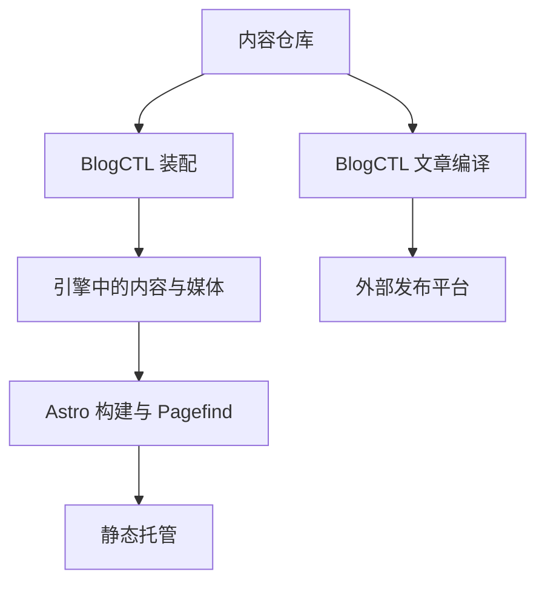

# 内容如何变成网站

Inkerio 把独立版本管理的内容仓库转换为双语静态网站。BlogCTL 装配构建输入，同时提供向外部平台分发文章的独立流程。

## 数据流

公开的 [inkerio-content-template](https://github.com/ThinkerQAQ/inkerio-content-template) 提供示例。搭建自己的站点时，可以由它创建内容仓库。引擎仓库保留现有名称 `ThinkerQAQ.github.io`。

## 各部分管理什么

| 部分 | 管理内容 |
| --- | --- |
| 内容仓库 | Markdown、翻译、原始媒体、健身记录及可选内容清单 |
| 引擎 `src/`、`astro.config.mjs` | 路由、布局、元数据、SEO、RSS 和内容 Schema |
| `tools/blogctl/` | 装配、文章编译、资源处理、分发、索引及浏览器 Bridge |
| `scripts/`、`src/markdown/` | 图表渲染及站点构建辅助 |
| `.github/workflows/` | 构建、发布与部署编排 |
| `workers/` | 单独配置的统计、报表、点赞与可选 AI 检索 |

装配会替换引擎生成的 `src/content/`。源媒体目录存在时，还会替换对应的引擎媒体目录。它不修改原始内容仓库；写作应在那里编辑和提交，之后可以反复装配或升级引擎。

[站点教程](../tutorial/first-site.md)通过两个本地仓库演示这个流程。产物位于 `dist/`，包含 Pagefind 索引。托管服务只需提供静态文件，无需运行 Go 或 Astro 服务。

## 搜索与分发

Pagefind 在浏览器中搜索已构建的网站。可选 AI Search 把符合条件的公开内容上传至 Cloudflare，提供独立检索；关闭问博客不会关闭 Pagefind。

站点构建不会向第三方账号发布文章。BlogCTL 按平台编译选定原文，再按明确的创建或更新目标执行。扩展访问浏览器登录会话，本地 Bridge 执行任务并记录结果。详见 [BlogCTL 工作流](../../../tools/blogctl/docs/zh-CN/guide/workflows.md)。

## 部署配置

当前工作流包含作者的 Pages、EdgeOne 部署、仓库身份限制及可选云服务。Fork 需要设置自己的身份、内容访问权限与托管资源，见[个性化配置](../how-to/customize-site.md)和[部署指南](../how-to/deploy.md)。

评论与浏览器服务见[站点集成](search-and-integrations.md)，扩展取舍见[架构原则](../architecture/principles.md)。
