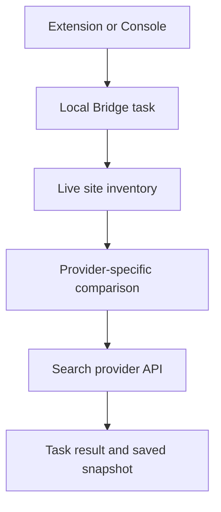

# Diagnose index submissions

Use the indexing page's TXT inventory and XML sitemap links to check the selected live site before submission. A provider accepting a request does not guarantee that its search index will include the page.

## Find the failing stage

The Console reaches the Bridge through the Extension relay. Native Messaging bootstraps that connection; task requests use authenticated local HTTP. Configured proxies affect provider and inventory requests.

Check the task's provider, site, HTTP status, attempted URL count and error. A local task ID is not evidence that the provider accepted the URLs.

## Baidu: over quota

An `HTTP 400: over quota` response means the attempted batch exceeds available quota. Check your site's quota in [Baidu Search Resource](https://ziyuan.baidu.com/linksubmit/index). The response alone does not tell you whether quota is zero or merely smaller than the batch.

Baidu maintains its own successful snapshot, independently of IndexNow. Without a successful Baidu baseline, all URLs may count as new, so incremental and full submissions can select the same set. Repeated full submissions do not fix quota exhaustion. A rejected batch does not become a successful baseline and is not automatically retried.

## Google: property mismatch or 403

Review `[search]` in `blogctl.toml`. The configured `google_property` is shared by Sitemap submission, URL Inspection, browser Request Indexing and CLI defaults.

`sc-domain:example.com` and `https://example.com/` are different properties. A service account's access to one does not grant access to the other. Confirm the exact configured property with a read-only Sites API check, then grant that service account access to it if needed. Do not rotate valid credentials solely because a different property is inaccessible.

The Sitemap action submits XML and TXT feeds. URL Inspection reads index state. Browser Request Indexing uses the inspection-derived queue. This workflow does not offer a general IndexNow-style Google URL-push API.

## Inventory or domain errors

Check that inventory URLs belong to the selected `site_origin`, are reachable, and correspond to the deployed build. `sitemap-all.txt` and `sitemap-inventory.json` are generated site resources, not local source files.

Domain migration resets foreign-origin snapshots before computing changes. Old-domain URLs must not turn into deletion requests against the new site. Inspection and browser queues also reject foreign-origin targets.

If incremental submission includes every URL, check whether that provider has a successful baseline and whether fingerprints are enabled. Missing fingerprints conservatively classify existing URLs as changed.

## Unsupported engines and ambiguous writes

360/Sogou controls currently return `submission_not_implemented`; they do not perform a remote submission. An enabled-looking engine card is not proof of an implemented provider.

After a timeout, inspect the task outcome before resubmitting. Preserve state and provider snapshots while diagnosing; deleting local data removes the incremental baseline.

See [configuration](../reference/configuration.md) and [CLI](../reference/cli.md). CLI `search submit` has no dry-run option.

API references: [Google Sitemaps](https://developers.google.com/webmaster-tools/v1/sitemaps/submit), [Baidu submission](https://ziyuan.baidu.com/linksubmit/index), [IndexNow](https://www.indexnow.org/documentation).
