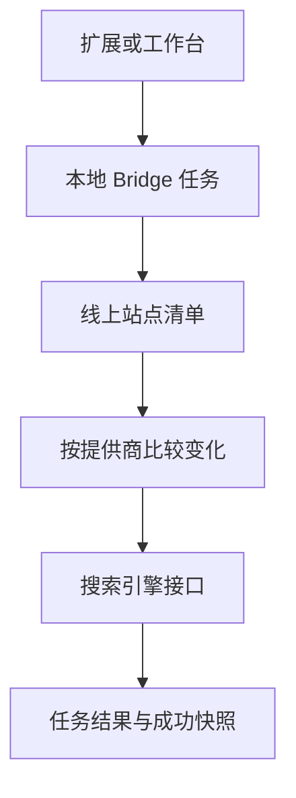

# 排查搜索引擎提交

提交前，通过索引页面的 TXT URL 清单和 XML Sitemap 链接，确认选中的线上站点。接口接受请求，不代表搜索引擎一定收录页面。

## 定位失败环节

工作台通过扩展转发访问 Bridge。Native Messaging 建立初始连接，任务使用本地认证 HTTP。配置的代理会影响站点清单和提供商请求。

检查任务的提供商、站点、HTTP 状态、实际尝试 URL 数量和错误。本地生成任务 ID，不代表远端接受了 URL。

## 百度：over quota

`HTTP 400: over quota` 表示本次批量超过可用额度。在[百度搜索资源平台](https://ziyuan.baidu.com/linksubmit/index)检查自己的站点额度。仅凭错误无法判断额度为零，还是小于本次批量。

百度使用独立于 IndexNow 的成功快照。没有成功基线时，全部 URL 都可能被视为新增，因此增量和全量可能选择同一批内容。反复全量提交不能解决额度不足。拒绝的批次不会成为成功基线，也不会自动重试。

## Google：Property 不匹配或 403

检查 `blogctl.toml` 的 `[search]`。Sitemap、URL Inspection、浏览器请求编入索引和 CLI 默认值共用 `google_property`。

`sc-domain:example.com` 和 `https://example.com/` 是两个不同资源。Service Account 拥有其中一个权限，不代表另一个也可访问。用只读 Sites API 确认准确的 Property，需要时为同一个服务账号授予对应权限。不要因为另一个资源无权访问，就替换有效凭据。

Sitemap 操作提交 XML 和 TXT Feed；URL Inspection 读取收录状态；浏览器请求编入索引使用检查结果生成的队列。此流程没有类似 IndexNow 的通用 Google URL 推送接口。

## 清单或域名错误

确认清单 URL 属于当前 `site_origin`、可以访问，并且来自实际部署版本。`sitemap-all.txt` 和 `sitemap-inventory.json` 是生成后的站点资源，不是本地原文。

迁移域名时，先重置其他域名的快照，再计算变化。旧域名不能变成新站点的删除请求。检查和浏览器队列也会拒绝跨域目标。

如果增量包含全部 URL，检查该提供商是否已有成功基线，以及是否启用指纹。缺少指纹时，会保守地将已有 URL 视为变化。

## 未实现的引擎与结果不明

360、搜狗目前返回 `submission_not_implemented`，不会真正提交。界面有卡片不代表接口已经实现。

超时后先检查任务结果再决定是否重提。排查时保留本地状态与提供商快照，删除数据会丢失增量基线。

另见[配置](../reference/configuration.md)和 [CLI](../reference/cli.md)。CLI `search submit` 没有 dry-run 参数。

接口参考：[Google Sitemaps](https://developers.google.com/webmaster-tools/v1/sitemaps/submit)、[百度提交](https://ziyuan.baidu.com/linksubmit/index)、[IndexNow](https://www.indexnow.org/documentation)。
