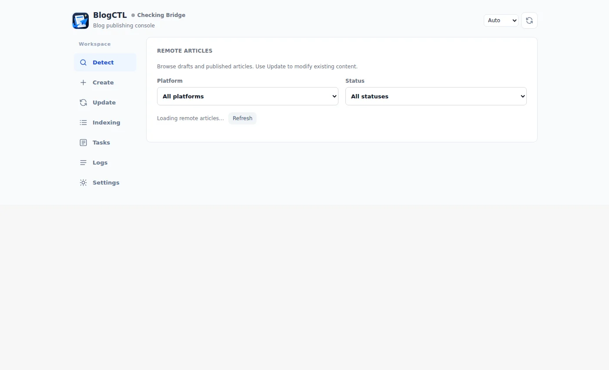
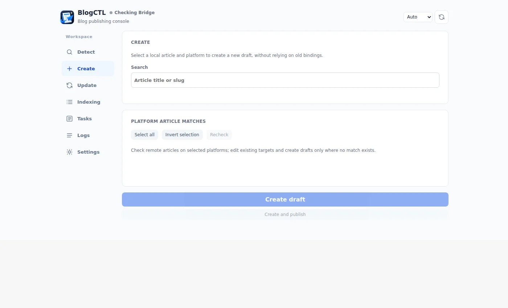
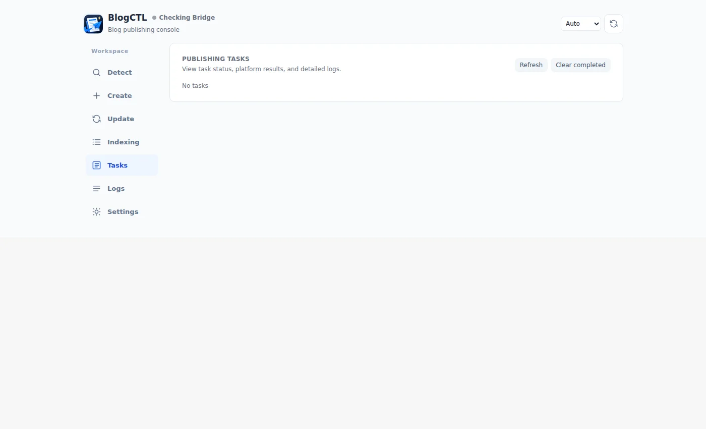

# 从源码建立 BlogCTL 工作区

这篇教程从引擎源码开始，先运行示例站点，再把 BlogCTL 接入浏览器。不需要发布平台账号即可完成安装；使用预编译程序时可直接看[安装指南](../quick-start.md)。

## 1. 获取源码并检查工具

安装 Git、Node.js 22.12+、npm、Go 1.27.1 或兼容的更新工具链。

```bash
git clone https://github.com/ThinkerQAQ/ThinkerQAQ.github.io.git
cd ThinkerQAQ.github.io
git --version
go version
node --version
npm --version
go run ./tools/blogctl/cmd doctor
npm ci
npm run dev:quick
```

打开 [localhost:4321](http://localhost:4321)，示例来源是引擎旁的 `inkerio-content-template`。在第二个终端进入引擎根目录执行 `npm run check`，完成后按 **Ctrl+C** 停止开发服务。

## 2. 构建并注册 BlogCTL

Linux/macOS Bash：

```bash
go run ./tools/blogctl/cmd/maint build
.build/out/blogctl install
```

Windows PowerShell，在已安装 Go 的 Windows 源码目录中：

```powershell
go build -o blogctl-windows-amd64.exe ./tools/blogctl/cmd
& .\blogctl-windows-amd64.exe install
```

程序需要匹配浏览器所在的操作系统。WSL 编译出的 Linux 程序不能直接作为 Windows Native Messaging 程序。Windows Edge 应使用 Windows 二进制，以及 Windows 可访问的引擎、内容路径。长期安装目录和升级方法见[安装指南](../quick-start.md)。

## 3. 加载匹配扩展

在浏览器扩展页开启开发者模式，加载该源码目录的 `tools/blogctl/extension/`。打开 BlogCTL，确认 Bridge 已连接，再点击「打开工作台」。

打开 `http://127.0.0.1:32145/v1/health`，或用 `curl`、PowerShell 查询。既要看健康响应，也要检查扩展连接状态；HTTP 正常不能单独证明浏览器转发正常。

## 4. 选择内容与语言

在「设置」填写程序可以访问的 Engine Root 和 Content Root。正式写作时，按 [Inkerio 教程](../../../../../docs/zh-CN/tutorial/first-site.md)克隆自己的内容仓库；首次体验也可直接选择示例仓库。

在「界面与语言」选择跟随浏览器、简体中文或 English，对应 `ui_locale`。各平台还有独立的文章语言配置。保存并重新打开设置，确认路径和语言已保存。

## 5. 检查并创建文章

在「检测」选择已登录平台，查看草稿和已发布内容。到「创建」选择本地文章与平台，需要关联结果时手动点击「检测」；创建页不会自动运行检测，也不以检测成功作为创建按钮的前提。

已有文章到「更新」打开候选链接并选择准确 ID。需要新增时才执行「创建草稿」，然后检查「任务」和编辑链接。本地编译与远端结果检查见[首个草稿教程](first-publish.md)。

## 界面示例

以下截图拍摄于 2026-10-10，用于说明导航布局，早于后续发布功能改动。当前按钮和手动检测行为以上文为准。







## 安装不成功时

| 现象 | 优先检查 |
| --- | --- |
| 浏览器找不到 Native Host | 程序系统是否匹配、路径是否固定、是否执行 `install` |
| 工作台可打开但不能操作 | 当前浏览器配置中的扩展是否启用并连接 |
| 没有本地文章 | Content Root、文章状态和语言 |
| WSL CLI 与 Windows 工作台的草稿不同 | 是否使用同一份且可访问的 `BLOGCTL_DATA_DIR` |
| 分配草稿后任务超时 | 先打开已保存 ID，不要直接重新创建 |

更多说明见 [Bridge 排查](../how-to/debug-bridge.md)和[数据路径配置](../reference/configuration.md)。
